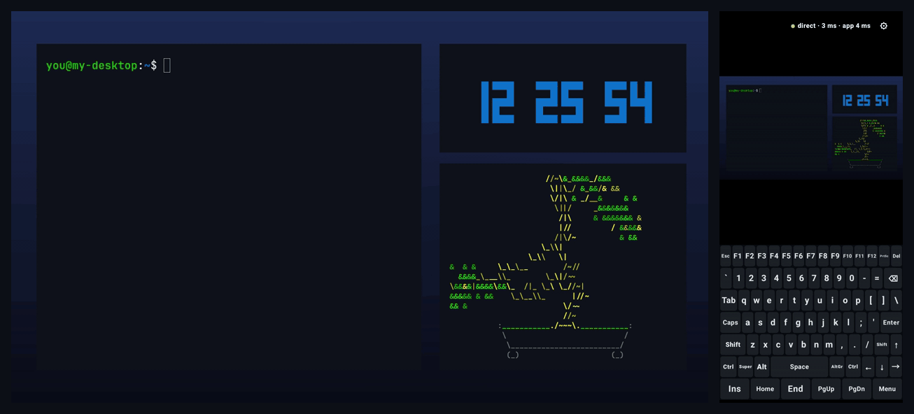
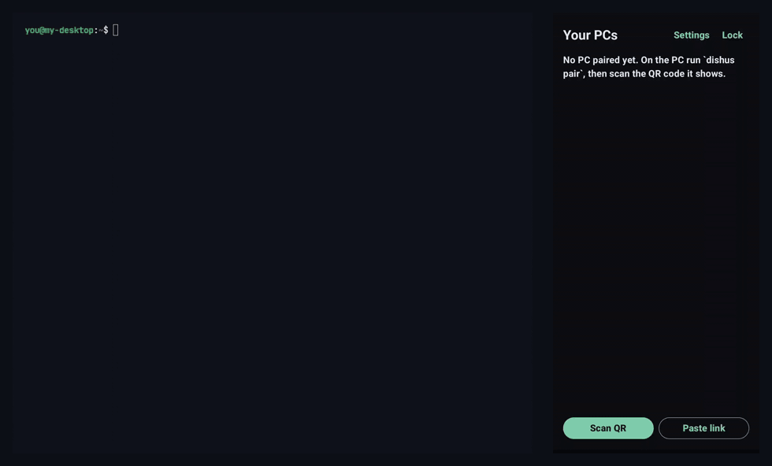

# DiShus — Distans Show/Use

Use your Android phone as the screen, keyboard and mouse of your Linux PC, from anywhere,
peer-to-peer. No accounts, no cloud service of ours, no port forwarding.

<p align="center">
  
  <br>
  <sub>Left: the PC. Right: the phone, which shows the PC screen live and works as its keyboard and touchpad.
  Recorded on a Galaxy Z Fold7's cover screen against a test desktop.</sub>
</p>

- **PC side:** `dishus-daemon` (a small Rust systemd *user* service) plus the `dishus` CLI.
- **Phone side:** a Kotlin/Compose app. The top 60 % shows the PC screen and works as a touchpad.
  The bottom 40 % is a full PC keyboard.
- **Network:** [iroh](https://iroh.computer) QUIC. Both ends are identified by public keys. The PC
  opens no listening TCP port. Connections are hole-punched directly when possible, and otherwise
  go through a relay (by default iroh's public relays, configurable). A relay only carries
  end-to-end-encrypted QUIC.
- **Licence:** MIT OR Apache-2.0.

> **Status: alpha (0.1.1).** Daily-tested on Hyprland + NVIDIA with a Galaxy Z Fold7, over Wi-Fi
> and mobile data. Other desktops, GPUs and phones should work but are less tested.
> See [Status](#status--whats-verified) for exactly what was verified.

## How it works

```
 phone (Compose UI)                                   PC (systemd --user)
 ┌──────────────────┐   iroh QUIC, ALPN dishus/session/1   ┌──────────────────────────────┐
 │ dishus-core (Rust│◄────────────────────────────────────►│ dishus-daemon                │
 │  via UniFFI)     │  bi-stream: control + input (reliable)│  allowlist gate (pre-parse)  │
 │ MediaCodec H.264 │  uni-stream per video frame (drop-old)│  uinput kbd + pointer        │
 └──────────────────┘                                       │  ├ capture worker (per session)
                                                            │  │  portal/PipeWire → GStreamer
                                                            │  │  NVENC → VA → x264 → openh264
                                                            └──┴───────────────────────────┘
                                                               ▲ unix socket (0600, uid-checked)
                                                               dishus CLI
```

- **Video.** Each encoded frame travels on its own QUIC uni-stream. The number of frames allowed in
  flight scales with the measured round-trip time (4 on a LAN, more on mobile data). If that is
  exceeded, or a frame misses its 1 s deadline, the PC drops or resets frames and asks the encoder
  for a keyframe, re-asking until one arrives. The phone never decodes a corrupted half-frame. It also asks for a keyframe on any
  sequence gap.
- **Adaptive bitrate and frame rate.** The rate starts at 30 fps. It steps up to 60 fps once the
  link has stayed clean, backs off by 30 % on congestion, and stays inside the bitrate range set by
  the quality preset.
- **Capture and encode** run in a separate worker process that exists only during a session. On
  NVIDIA, NVENC costs ~300 MB of driver mappings, and that memory is gone as soon as you disconnect.
- **Input** goes through `/dev/uinput` as evdev *physical* keycodes. The PC's keyboard layout
  applies, and the on-screen keyboard is labelled US-QWERTY. Every held key and button is released
  on disconnect, on a 5 s silence, on revoke, and on kill. Power, sleep and wake keys are refused.
- **Pointer** works like a laptop touchpad (relative):
  - one finger moves, tap = left click
  - long-press or two-finger tap = right click
  - double-tap-and-hold = drag
  - two fingers = scroll
  - pinch = zoom the phone view

Design decisions and their reasons are in [docs/PLAN.md](docs/PLAN.md). The threat model is in
[docs/SECURITY.md](docs/SECURITY.md).

## Quick start (for friends)

You need a Linux PC (Wayland with a screen-share portal, or X11) and an Android phone (Android 9 or newer).

1. **Download** both files from the [latest release](https://github.com/SunqdXX/dishus/releases/latest):
   `dishus-…-linux-x86_64.tar.gz` (PC) and `DiShus-….apk` (phone).
2. **PC:** unpack and run the installer. It installs for your user only. First it test-encodes
   video with every encoder your PC could use (NVIDIA, Intel/AMD graphics, or the CPU), and if
   something is missing it prints the one install command for your distro and GPU. Any PC works:
   without a supported GPU, DiShus encodes on the CPU.
   ```sh
   tar xf dishus-*-linux-x86_64.tar.gz && cd dishus-*-linux-x86_64 && ./install.sh
   ```
   For example, Arch with Intel graphics:
   `sudo pacman -S --needed gst-plugin-va intel-media-driver gst-plugin-pipewire gst-plugins-ugly`.
   Check again any time with `dishus doctor`.
   The prebuilt PC binaries need glibc ≥ 2.39 (Arch, Ubuntu 24.04+, Debian 13+, Fedora 40+).
   On older systems, build from source (below).
3. **Phone:** open the APK to install it (allow "install unknown apps" for your browser or file
   manager when Android asks). Start DiShus and choose an app password.
4. **Pair:** on the PC run `dishus pair`, allow screen sharing (tick *remember* / *allow restore
   token*), then tap **Scan QR** in the app (or copy the `dishus://pair?…` link it prints and use
   **Paste link**). The code is valid for 60 s and one use. Done: tap **Connect**.

   
5. **Stay paired:** a pairing lasts 6 months; renew it while connected (settings panel → *Renew 6 months*) or on the PC with
   `dishus renew <phone>`. `dishus kill` on the PC cuts every session at once (`dishus unlock` undoes it).

Works over the internet too (mobile data, other Wi-Fi): no port forwarding, no account, no server
of ours. The connection is end-to-end encrypted between your phone and your PC.

## Install (PC) from source

Arch: `packaging/aur/PKGBUILD` (`dishus-git`) builds from this repository:

```sh
mkdir -p /tmp/dishus-pkg && cp packaging/aur/PKGBUILD /tmp/dishus-pkg/ && cd /tmp/dishus-pkg
makepkg -si
```

Or build by hand (Rust ≥ 1.89, GStreamer 1.24+ dev files):

```sh
cargo build --release -p dishus-daemon -p dishus-cli
install -Dm755 target/release/dishus-daemon ~/.local/bin/dishus-daemon
install -Dm755 target/release/dishus        ~/.local/bin/dishus
install -Dm644 packaging/systemd/dishus.service ~/.config/systemd/user/dishus.service
# edit ExecStart= to ~/.local/bin/dishus-daemon if you installed there
```

Runtime packages (Arch names):
- **Required:**
  - `gstreamer`, `gst-plugins-base-libs`
  - `gst-plugins-bad-libs`: NVENC (`nvcodec`) and `h264parse`
  - `gst-plugin-pipewire`, `pipewire`, `xdg-desktop-portal`
  - the portal backend for your desktop (`xdg-desktop-portal-hyprland`, `-gnome`, `-kde`, …)
- **An H.264 encoder** (at least one; `dishus doctor` tells you which work):
  - NVIDIA: included in `gst-plugins-bad-libs`, plus the proprietary driver
  - Intel: `gst-plugin-va` + `intel-media-driver`; AMD: `gst-plugin-va` (driver is in `mesa`)
  - any CPU: `gst-plugins-ugly` (x264)
- **Optional:**
  - `gst-plugins-bad`: openh264
  - `gst-plugins-good`: X11 capture

### 1. Let the daemon create input devices

The daemon needs write access to `/dev/uinput`. Check first:

```sh
getfacl /dev/uinput     # your user, or a group you are in, needs rw
```

If you lack access, install the shipped rule. It grants access to whoever is logged in at the
local seat. It is not installed automatically, because on a multi-user machine uinput access means
being able to type into anyone's session.

```sh
sudo install -Dm644 /usr/share/dishus/70-dishus-uinput.rules /etc/udev/rules.d/
echo uinput | sudo tee /etc/modules-load.d/uinput.conf
sudo udevadm control --reload && sudo modprobe uinput && sudo udevadm trigger
```

Without uinput the daemon still runs, as view-only. `dishus status` shows `input: none`.

### 2. Start the daemon

```sh
systemctl --user enable --now dishus.service
dishus status
```

The unit is not tied to `graphical-session.target`, because plain Hyprland, without uwsm, never
reaches it. For screen capture, the portal must see your compositor's environment. Most setups do
that already (Hyprland, for example, with
`exec-once = dbus-update-activation-environment --systemd --all`). The X11 fallback also needs
`DISPLAY` in the user manager: `systemctl --user import-environment DISPLAY`.

### 3. Pair the phone (at the PC)

```sh
dishus pair
```

1. **Screen-capture permission.** `dishus pair` first opens your desktop's screen-share dialog.
   Pick the screen(s), and on Hyprland tick **"Allow a restore token"**. The permission is stored
   as a restore token, so later remote sessions don't hit a dialog nobody is there to click. You
   can re-run this alone with `dishus setup-capture`.
   - xdph users can make the restore-token box default to on with
     `screencopy { allow_token_by_default = true }` in `~/.config/hypr/xdph.conf`.
2. **QR code.** It then shows a QR code and a `dishus://pair?…` link. The link is valid for 60 s
   and for one use. Scan it in the app (**Scan QR**), or paste the link.
3. **Confirmation.** The CLI prints the new device when pairing succeeds.

### Remote use after a reboot: auto-login is required

`dishus-daemon` is a *user* service. It runs only while you have a logged-in session, and screen
capture needs a running compositor. For "PC rebooted while I'm away" to work, configure **automatic
login into your graphical session**. Pair it with a lock screen (hyprlock etc.) if the PC is
physically accessible: you will see the lock screen remotely and can type your password from the
phone keyboard.

Configure auto-login in your display manager, for example SDDM `[Autologin]` or greetd
`initial_session`. DiShus does not change it for you.

### Hyprland: no screen-share dialog when the phone connects

The restore token normally makes reconnects silent. xdph still shows its picker when it rejects
the stored token (for example one written under another desktop, or after an xdph update), and
then nobody is at the PC to click it. (With no token at all, the phone is refused: pair at the PC
first.) DiShus ships a small picker wrapper that answers that dialog
for DiShus only, and leaves every other app's screen-share request to your normal picker:

```sh
install -Dm755 packaging/hyprland/dishus-share-picker ~/.local/bin/dishus-share-picker
# from a release tarball, install.sh has already put it there
```

`~/.config/hypr/xdph.conf`:

```
screencopy {
    allow_token_by_default = true
    custom_picker_binary = /home/YOU/.local/bin/dishus-share-picker
}
```

then `systemctl --user restart xdg-desktop-portal-hyprland`. If you already used a custom picker,
put its path on the first line of `~/.config/dishus/share-picker-fallback`.

How it decides: while the daemon's capture worker is waiting for the portal *for a phone*, it
creates `$XDG_RUNTIME_DIR/dishus/autoshare` (mode 0600, yours). The wrapper takes that file
(one use, at most 20 s old, must be a regular file you own) and answers "the focused monitor,
whole screen, remember it". With no such file, it starts your normal picker unchanged. `dishus
pair` and `dishus setup-capture` never create the file, so at the PC you always get the real
dialog. Each answer is logged: `journalctl -t dishus-share-picker`.

Restore tokens are also stored per desktop (`portal-restore-token-<desktop>`), so switching
between, say, Hyprland and Plasma no longer throws away the other desktop's permission.

## CLI

```
dishus status                  daemon state, PC id, relays, capture/input backends, sessions
dishus pair [--skip-capture-setup]
dishus list                    paired phones, expiry, last seen
dishus renew <name|id> [--days N]   extend (1–180 days, default 180)
dishus revoke <name|id>        remove a phone and cut its session immediately
dishus kill                    PANIC: cut every session and refuse everything until…
dishus unlock                  …you leave lockdown (lockdown survives restarts)
dishus setup-capture           re-grant screen-capture permission
dishus doctor                  can this PC stream? test-encodes with every encoder, says what to install
```

`list` and `revoke` also work when the daemon is stopped; they edit the device file directly.
`kill` falls back to `systemctl --user stop dishus.service` if the daemon doesn't answer. The
daemon sends a desktop notification for pairings, connects, disconnects, revokes and kill.

## Configuration

`~/.config/dishus/config.toml` (created with defaults; unknown keys are rejected):

```toml
pc_name = "my-desktop"        # shown on the phone (default: hostname)
relays = []                   # [] = iroh's public relays; or ["https://relay.example.org/"]
disable_relays = false        # true = direct connections only (LAN / reachable hosts)
expiry_days = 180             # pairing lifetime, 1..=180
pairing_ttl_secs = 60         # pairing link lifetime, 10..=60
udp_port = 0                  # 0 = random; set to pin a port for a firewall/port-forward rule

[video]
encoder = "auto"              # auto | nvenc | vaapi | vaapi-lp | x264 | openh264
max_bitrate_kbps = 20000      # ceiling for the adaptive controller
show_cursor = true
```

Restart the daemon after editing (`systemctl --user restart dishus`). The phone has its own relay
list under **Settings**. To use a self-hosted relay
([iroh-relay](https://github.com/n0-computer/iroh)), set it on both sides.

Files the daemon keeps (all `0600` in `0700` directories; group- or world-readable files are
refused):

| Path | Content |
|---|---|
| `~/.config/dishus/secret.key` | PC identity (Ed25519) |
| `~/.config/dishus/devices.toml` | allowlist: phone public keys, names, expiry |
| `~/.local/state/dishus/` | portal restore tokens (one per desktop), lockdown flag |
| `$XDG_RUNTIME_DIR/dishus/control.sock` | CLI socket |
| `$XDG_RUNTIME_DIR/dishus/autoshare` | present only while a phone's capture request waits for the portal (Hyprland picker wrapper) |

Logging: `DISHUS_LOG=debug` (a `tracing` filter). Secrets and tokens are never logged.

## Phone app

- **First start.** Choose an app password. It derives (Argon2id) the key that encrypts the phone's
  identity and its list of paired PCs. The encrypted blob is then wrapped again by an Android
  Keystore key (StrongBox when available). Fingerprint or face unlock is optional. There is no
  recovery: if you forget the password, wipe the app data and pair again.
- **Pairing.** Scan the QR from `dishus pair`.
- **Connecting.** Tap a PC. With one paired PC, or "connect to last PC" on, it connects
  immediately after unlock.
- **Screen.** Gear icon opens quick settings:
  - frame rate (Adaptive / 30 / 60), quality, resolution cap, monitor
  - renew the pairing for 30 days or 6 months
  - connection path (direct or relay) and app-level round-trip time
  - relay and app settings, disconnect
- **Keyboard.** Modifier keys: tap = applies to the next key; long-press = locked until tapped
  again. Holding a normal key auto-repeats on the PC.
- **Privacy.** The app locks after the configured time in the background, and drops the session
  whenever it leaves the foreground. Screenshots and the recents thumbnail are blocked by default
  (`FLAG_SECURE`; *Settings → Allow screenshots* lifts it everywhere except the lock screen).
  Backups are disabled.

### Building the app

Needs the Android SDK (API 35), NDK 27, `cargo-ndk`, and Rust targets `aarch64-linux-android`
and `x86_64-linux-android`.

```sh
./android/build-rust.sh          # Rust core for arm64 + x86_64, then Kotlin bindings
cd android && gradle assembleDebug
```

Releases: `packaging/make-release.sh` builds the PC tarball and the signed APK into `dist/`. It
needs `DISHUS_KEYSTORE_PROPERTIES` pointing at a properties file (`storeFile`, `storePassword`,
`keyAlias`, `keyPassword`) for the release key, which never goes into the repository.

## Repository layout

| Crate / dir | What |
|---|---|
| `crates/dishus-proto` | wire messages, framing with size caps, validation, pairing URI, keycode policy |
| `crates/dishus-daemon` | daemon: iroh endpoint, allowlist gate, pairing, sessions, ABR, uinput, IPC, capture worker |
| `crates/dishus-cli` | `dishus` command |
| `crates/dishus-core` | phone-side core: encrypted vault, iroh client, UniFFI API; `examples/desktop_client.rs` test client |
| `android/` | Compose app |
| `packaging/` | systemd unit, AUR PKGBUILD, udev rule |
| `docs/` | plan & decisions, security, manual test checklist |

Development checks (the same ones CI runs):

```sh
cargo fmt --all --check
cargo clippy --workspace --all-targets -- -D warnings
cargo test --workspace
cargo deny check && cargo audit
```

`cargo run -p dishus-core --example desktop_client -- --help` gives a desktop "phone": it can
pair, stream video to stdout (`… view | ffplay -f h264 -`), send keys and renew.

## Status — what's verified

Tested on Arch Linux, Hyprland 0.57, NVIDIA RTX, NVENC, with a Samsung Galaxy Z Fold7
(Android 16), on 2026-11-08. "10/10" means the scenario was run ten times in a row.

**Verified:**

| | |
|---|---|
| ✅ | 73 automated tests (protocol, pairing, expiry/renew, allowlist, revoke, kill/lockdown, idle timeout, held-key release on silence, split frames, slow capture start, stuck-video recovery, vault crypto, frame-rate cap on a live pipeline); end-to-end suite run repeatedly with no flakes |
| ✅ | Soak suite against isolated daemons (test source and X11 on Xvfb): every scenario ×10 — pairing, renew, revoke, kill/unlock, expiry, quick restarts (single instance, port kept), worker leaks, memory |
| ✅ | **Real desktop on the phone through the Wayland portal** (Hyprland, xdph restore token, PipeWire, NVENC, 180 Hz monitor): 30 fps cap held 10/10 with 1 keyframe and no gaps; on LAN the phone runs at 60 fps with every received frame rendered, 3–4 ms |
| ✅ | CPU encoding (x264) on the real desktop at 2560×1440: 30 fps 10/10, no gaps, ~90 % of one core; `dishus doctor` and the installer tested with plugins hidden (fresh-install case) |
| ✅ | Hyprland, no dialog at the PC: rejected token answered by `dishus-share-picker` 10/10; valid token reused without calling the picker 10/10; phone disconnect/reconnect 10/10 |
| ✅ | KDE Plasma (Wayland portal): video, restore token reused 10/10 without a dialog |
| ✅ | The signed release APK and tarball, installed from GitHub Releases on a clean PC and phone |
| ✅ | CI: build, tests, clippy, fmt, cargo-deny / audit, Android build |
| ✅ | Phone ↔ PC on the phone: connect/video/back 10/10; exact key codes incl. F1–F12 10/10; tap, move, right-click, drag 10/10; renew 10/10; revoke + re-pair 10/10; held key released when the app leaves the foreground 10/10 |
| ✅ | Network changes on the phone: Wi-Fi off/on 10/10 recovers by itself; video over **mobile data** verified |
| ✅ | PC daemon restart mid-session: phone reconnects by itself (~3 s); `dishus kill` / `unlock` shown and recovered on the phone |

**Not verified:**

| | |
|---|---|
| ⚠️ | GNOME portal (same code path as Hyprland and KDE, but never run there); phone input on KDE |
| ⚠️ | A real X11 desktop (only Xvfb) |
| ⚠️ | VA-API on Intel/AMD (no such GPU here; `dishus doctor` reports it), openh264. Install hints for Ubuntu/Debian and Fedora are unverified on those systems (Arch's are checked against the repos) |
| ⚠️ | Other phones / Android versions than the one above |

**Known gaps and limits:**

- **Memory.** Measured by the service's cgroup (what the kernel actually charges): idle ≈ 36 MB;
  **streaming to a phone ≈ 115 MB, peak 121 MB** (daemon + NVENC capture worker). `ps` shows the
  worker at ≈ 300 MB RSS, but most of that is shared NVIDIA driver mappings. The worker exits when
  the session ends. VA and x264 workers are unmeasured.
- **No zero-copy.** PipeWire buffers are SHM, which costs one copy per frame to the encoder. A
  DMA-BUF → CUDA import is future work.
- **Displayed RTT is app-level.** The latency number is the control-stream ping, not
  glass-to-glass latency. Measure that with the checklist in [docs/TESTING.md](docs/TESTING.md).
- **Keyboard layout.** The on-screen keyboard is US-QWERTY-labelled; keys follow the PC's layout.
- **One session at a time.** A newer connection replaces the older one.

## Licence

Dual-licensed under [MIT](LICENSE-MIT) or [Apache-2.0](LICENSE-APACHE), at your option.
