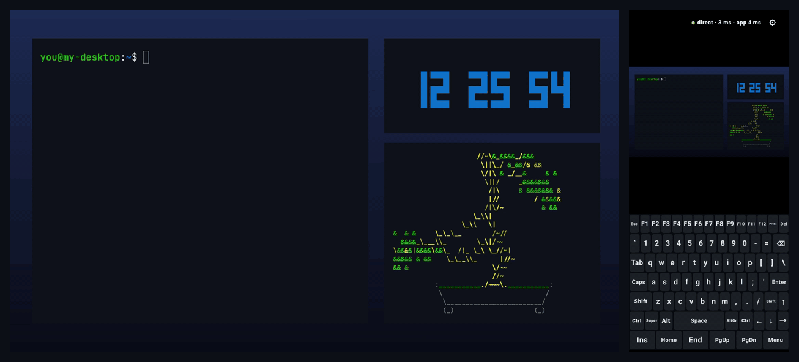
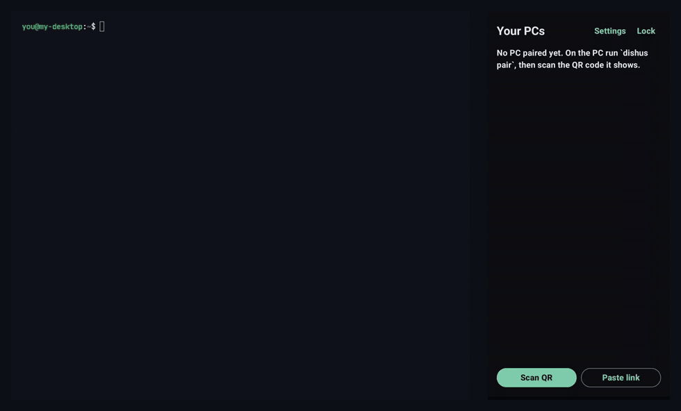

# DiShus

Your Android phone becomes the screen, keyboard and mouse of your own PC, over the internet.
The phone shows the PC screen live; the top half is a touchpad, the bottom half a full PC keyboard
(Ctrl, Alt, Super, Esc, F1 to F12, arrows).

Peer to peer: the phone connects straight to your PC. No account, no server of ours, no port
forwarding. Free and open source.

<p align="center">
  
</p>

## What works

| | Status |
|---|---|
| Linux, Hyprland (Wayland) | tested by us: picture, keyboard, mouse, sound |
| Linux, X11 (XFCE) | picture tested by us on XFCE (keyboard and mouse there not checked); **in main, not in a release yet**: the 0.31 download can fail to stream on X11 |
| Linux, KDE Plasma | reported working by friends |
| Windows (the exe) | tested by a friend on their PC; in our VM: install, pairing, keyboard, mouse (no video in the VM, no real phone); no sound |
| Android | needs Android 9 or newer; tested on Samsung Galaxy phones with Android 16, older versions untested |
| Graphics | NVIDIA, Intel, and no graphics card (CPU encoding) reported working |
| Networks | home Wi-Fi, mobile data, a switch between them (reconnects in about a second) |

Not tested: GNOME, AMD graphics, other phone brands, multi-monitor X11, X11 with LightDM or GDM.
If you try one, open an issue.

## Not supported yet

- **No login screen or boot.** DiShus runs inside your logged-in session. After a restart it
  starts only once you log in at the PC.
- **No sound from Windows PCs.** Sound works with Linux PCs only.
- **No file sending.**
- **No iPhone.** Apple needs a $99/year developer account to install apps.
- No Mac PC.
- Windows: no video on PCs whose graphics have no video processor (for example without a GPU
  driver). The Windows lock screen, Ctrl+Alt+Del screen and UAC prompts can't be seen or used
  (Windows doesn't let apps do that).

## Install

Get the files from the [latest release](https://github.com/SunqdXX/dishus/releases/latest): one for
the PC, plus the APK for the phone.

**Windows:** run `DiShus-<version>-windows-x86_64.exe`. No admin rights needed. It isn't signed, so
click **More info → Run anyway**, then **Allow** at the firewall prompt. It installs for your user,
starts with your sign-in, and shows a QR code.

**Linux** (glibc 2.39+: Arch, Ubuntu 24.04+, Debian 13+, Fedora 40+; older: [build it
yourself](#building-from-source)):

```sh
tar xf dishus-*-linux-x86_64.tar.gz
cd dishus-*-linux-x86_64
./install.sh
dishus pair
```

`install.sh` puts everything in your home folder, checks which video encoders work and prints the
one command to install anything missing. It may also print `sudo` commands for [keyboard and
mouse access](#keyboard-and-mouse-access). On Wayland, `dishus pair` first asks which screen to
share: pick the **whole screen** and tick "remember" (Hyprland: "Allow a restore token").

**Updating on Linux:** run `./install.sh` from the new release. It replaces the binaries and the
systemd unit (the X11 fix needs the new unit) and restarts DiShus; a connected phone drops for a
few seconds and reconnects by itself.

**Phone:** install the APK, open DiShus and choose an app password (it locks the app and encrypts
your pairings; it can't be recovered). Tap **Scan QR** and scan the PC's code, then tap your PC and
**Connect**.



## Pairing and expiry

- A pairing code works once, for 60 seconds.
- A pairing lasts **180 days** (set `expiry_days`, 1 to 180, in the PC's config).
- Renew it while connected: in the app's quick settings (**Renew 30 days** or **Renew 6 months**),
  or on the PC with `dishus renew <phone>` (180 days, or `--days 1` to `180`).
- `dishus list` shows each phone's expiry. `dishus revoke <phone>` removes one. `dishus kill` cuts
  every connection and refuses new ones until `dishus unlock`.

## Using it

- Touchpad: one finger moves, tap clicks, two-finger tap or long-press right-clicks, double-tap
  and hold drags, two fingers scroll, pinch zooms the picture.
- Ctrl/Alt/Shift/Super: tap for the next key, long-press to hold. Keys follow your PC's layout;
  the labels are US.
- The gear opens quick settings: frame rate, quality, resolution, monitor, renew, direct or relay.
- **Sound (Linux PCs):** the speaker button plays the PC's sound on the phone, with a volume
  slider in quick settings. Off until you turn it on; while off, the PC records nothing. About
  0.1 s behind the picture. Needs 0.31 or newer on both sides.
- **Lock screen:** if your logged-in session locks (idle or `loginctl lock-session`), the phone
  shows the lock screen and you can type your password from it. Tested only with Caelestia's lock
  on Hyprland; hyprlock, KDE, GNOME and other lockers are untested.

## Security

- **Never share your pairing QR code or `dishus://pair` link.** Whoever uses it first within
  60 seconds controls your PC until you revoke them.
- Only paired phones can connect, each with its own key; everything is end-to-end encrypted. Relays
  (iroh's public ones, or your own) only forward data they can't read. The PC opens no port.
- The app is locked with your password; pairings are encrypted with it and an Android Keystore key.
- Power, sleep and wake keys from the phone are refused.
- Lost your phone? `dishus kill`, then `dishus revoke <phone>`.

Details: [docs/SECURITY.md](docs/SECURITY.md).

## When something goes wrong

Run `dishus doctor` (checks what's missing) and `dishus status`. Logs: `journalctl --user -u dishus
-e` on Linux, `%LOCALAPPDATA%\dishus\logs` on Windows. Open an issue with them.

- **Wrong screen remembered (Linux):** `rm -f ~/.local/state/dishus/portal-restore-token*` then
  `dishus setup-capture`.
- **Picture but no typing:** on Linux, see below. On Windows, the target window runs as admin.

### Keyboard and mouse access

On Linux DiShus types through a virtual keyboard and mouse (`/dev/uinput`), which most distros
let only root create. Once, from the release folder:

```sh
sudo install -Dm644 70-dishus-uinput.rules /etc/udev/rules.d/70-dishus-uinput.rules
echo uinput | sudo tee /etc/modules-load.d/uinput.conf
sudo udevadm control --reload && sudo modprobe uinput && sudo udevadm trigger
systemctl --user restart dishus
```

The rule gives access to whoever sits at the PC. It isn't installed automatically: on a PC shared
by several people it lets one user type into another's session. Without it DiShus is view-only.

### Hyprland: no screen-share popup on the PC

Hyprland may show its "pick a screen" popup when the phone connects, with nobody there to click
it. `install.sh` copies a helper that answers it for DiShus only. Add to `~/.config/hypr/xdph.conf`
(your own home path):

```
screencopy {
    allow_token_by_default = true
    custom_picker_binary = /home/YOU/.local/bin/dishus-share-picker
}
```

then `systemctl --user restart xdg-desktop-portal-hyprland`. An existing custom picker: put its path
on the first line of `~/.config/dishus/share-picker-fallback`. The helper answers only while DiShus
waits on a phone (20 s at most) and logs to `journalctl -t dishus-share-picker`.

## Settings

Optional `config.toml` in `~/.config/dishus/` (Linux) or `%APPDATA%\dishus\` (Windows):

```toml
pc_name = "my-desktop"        # name shown on the phone
relays = []                   # empty = iroh's public relays, or ["https://relay.example.org/"]
disable_relays = false        # true = direct connections only
expiry_days = 180             # pairing lifetime, 1 to 180
pairing_ttl_secs = 60         # pairing code lifetime, 10 to 60
udp_port = 0                  # 0 = random

[video]
encoder = "auto"              # Linux: auto, nvenc, vaapi, vaapi-lp, x264, openh264
                              # Windows: auto, nvenc, qsv, amf, hardware, software
max_bitrate_kbps = 20000
show_cursor = true
```

Restart after editing: `systemctl --user restart dishus`, or on Windows open the installer again.

## Uninstall

Windows: `dishus uninstall`. Linux: `./install.sh --uninstall` (and remove the udev rule and
`/etc/modules-load.d/uinput.conf` if you added them). Pairings stay in `~/.config/dishus` /
`%APPDATA%\dishus` until you delete them.

## Building from source

**Linux** (Rust 1.89+, GStreamer 1.24+ development files):

```sh
cargo build --release -p dishus-daemon -p dishus-cli
install -Dm755 -t ~/.local/bin/ target/release/dishus-daemon target/release/dishus
mkdir -p ~/.config/systemd/user
sed 's|^ExecStart=.*|ExecStart=%h/.local/bin/dishus-daemon|' packaging/systemd/dishus.service \
  > ~/.config/systemd/user/dishus.service
systemctl --user daemon-reload && systemctl --user enable --now dishus
```

At runtime: GStreamer with its PipeWire plugin, `h264parse` and one H.264 encoder; `dishus doctor`
checks it. Arch: `packaging/aur/PKGBUILD`.

**Windows** (Rust MSVC, VS Build Tools "Desktop development with C++"):
`packaging\windows\build.ps1` builds the installer into `dist\`.

**Phone** (Android SDK 35, NDK 27, `cargo-ndk`): `./android/build-rust.sh`, then
`cd android && gradle assembleDebug`.

Tests: `cargo fmt --all --check`, `cargo clippy --workspace --all-targets -- -D warnings`,
`cargo test --workspace`. CI runs them on Linux and Windows, plus the Android build. Design notes:
[docs/PLAN.md](docs/PLAN.md).

## Thanks

Windows support was built by [yasinlol](https://github.com/yasinlol).

## Licence

MIT or Apache-2.0, your choice. See [LICENSE-MIT](LICENSE-MIT) and [LICENSE-APACHE](LICENSE-APACHE).
